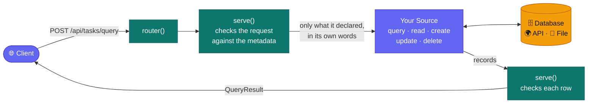

# 🧩 @bh/source

**Serve any resource through bh's contract, wherever its rows live: a database,
an external API, a file.**


A **source** says where a resource's rows live and how it serves each
operation (`query`, `read`, `create`, `update`, `delete`), each declared
apart. Every capability is a _translation_ into the source's own words: a
filter's operator as its request, a sort as its sort key, a field as its key
in a body. **`serve`** makes the resource's metadata from those declarations
and the kinds, so `GET /meta` says exactly what this source can do, and never
more.

## ✨ Highlights

- 🛡️ **Checked at four points:** the declarations when served (a mistake
  throws, listing every one), each request against the metadata, each
  operation's own `check`, and each row the source answers.
- 🧠 **In memory for free:** a source that answers every row at once
  (`paging: 'none'`) gets every operator, sort, group, search and page its
  kinds allow, by the same `matchesFilter` a client uses.
- 📄 **Any paging:** by offset, by page number, or after the source's own
  cursor, which bh wraps with the query it's for. Clients always see
  `{ skip, take }` and `{ cursor, take }`.
- 🔌 **No web framework:** `router` puts the contract's routes on one
  function. Hono, Fastify, Express, Bun or `node:http` each take it in a few
  lines.
- 🧪 **A conformance kit:** `@bh/source/testing` holds each declared operator
  and sort to the contract, so an adapter's tests prove what it claims.

## 🔄 How a request flows



## 🚀 Quick start

Serve each resource, put them under one router, and hand it your server's
requests:

```ts
import { router, serve } from '@bh/source';
import { postgres } from '@bh/source-postgres';
import { githubIssues } from '@bh/source-github';

const issues = githubIssues({
  repo: 'owner/name',
  token: process.env.GITHUB_TOKEN,
});

const route = router([
  serve(tasks, postgres({ query })), // a table
  serve(issues.definition, issues.source), // an external API
]);
```

Each resource is served under its own name, and two of one name throw, so
neither hides the other. The router takes a plain request and gives back a status and a body, so one
fetch handler serves it on Hono, Bun, Deno or Cloudflare Workers:

```ts
export async function handle(request: Request): Promise<Response> {
  const url = new URL(request.url);
  const answer = await route({
    method: request.method,
    path: url.pathname.replace(/^\/api/, ''), // '/tasks/7'
    query: Object.fromEntries(url.searchParams), // DELETE's ?version=
    body: request.body ? await request.json() : undefined,
    ctx: { viewer: await viewerOf(request), signal: request.signal },
  });
  return answer.body === undefined
    ? new Response(null, { status: answer.status })
    : Response.json(answer.body, { status: answer.status });
}

// Hono: app.all('/api/*', (c) => handle(c.req.raw));
```

> [!TIP]
> `ctx.viewer` is the signed-in user's id, for the `isMe` operator, and
> `ctx.signal` aborts the source's work when the client goes away. `viewerOf`
> stands for your app's own auth.

## 📡 Routes

| Method   | Path                        | Body       | Answers                                         |
| -------- | --------------------------- | ---------- | ----------------------------------------------- |
| `GET`    | `/<resource>/meta`          |            | `200` the metadata: what each field can do      |
| `POST`   | `/<resource>/query`         | a `Query`  | `200` a `QueryResult`: its rows or groups, page |
| `GET`    | `/<resource>/:id`           |            | `200` the row                                   |
| `POST`   | `/<resource>`               | a `Create` | `201` the row                                   |
| `PATCH`  | `/<resource>/:id`           | a `Patch`  | `200` the row                                   |
| `DELETE` | `/<resource>/:id?version=…` |            | `204`                                           |

Every failure answers one shape, `{ error: { code, message, issues? } }`:

| Code        | Status | When                                                 |
| ----------- | ------ | ---------------------------------------------------- |
| `invalid`   | 400    | the body is out of shape, or asks what isn't offered |
| `not_found` | 404    | no such route or row                                 |
| `conflict`  | 409    | the row changed since it was read                    |
| `internal`  | 500    | anything else the source threw; the server logs it   |

## ✍️ Writing a source

### 📄 A file, served in memory

A source that answers every row at once declares nothing about filters or
sorts: bh serves them all, as each field's kind allows.

```ts
import { readFile } from 'node:fs/promises';
import { serve, type ResourceDefinition, type Source } from '@bh/source';

interface Task {
  id: number;
  title: string;
  status: string;
  tags: string[];
}

const statuses = [
  { value: 'todo', label: 'To do', order: 0 },
  { value: 'done', label: 'Done', order: 1 },
];

const tasks: ResourceDefinition = {
  resource: 'tasks',
  label: { one: 'Task', other: 'Tasks' },
  roles: { idField: 'id', titleField: 'title' },
  fields: [
    {
      key: 'id',
      label: 'Id',
      type: { kind: 'number', settings: { integer: true } },
    },
    {
      key: 'title',
      label: 'Title',
      type: { kind: 'text' },
    },
    {
      key: 'status',
      label: 'Status',
      type: { kind: 'option', settings: { options: statuses } },
    },
    {
      key: 'tags',
      label: 'Tags',
      type: { kind: 'text', many: true },
    },
  ],
  sort: [{ field: 'status', dir: 'asc' }],
};

const file: Task[] = JSON.parse(await readFile('tasks.json', 'utf8'));

const fileSource: Source<Task, never, Task[], Partial<Task>> = {
  // Our fields from the source's record: one reader per field.
  row: {
    id: (task) => task.id,
    title: (task) => task.title,
    status: (task) => task.status,
    tags: (task) => task.tags,
  },
  query: {
    paging: 'none',
    run: async () => file,
    records: (answer) => answer,
  },
  read: { run: async (id) => file.find((task) => task.id === id) ?? null },
  create: {
    fields: {
      title: { required: true, to: (value) => ({ title: value as string }) },
      status: { default: 'todo', to: (value) => ({ status: value as string }) },
    },
    run: async (body) => {
      const task: Task = {
        id: file.length + 1,
        title: '',
        status: 'todo',
        tags: [],
        ...body,
      };
      file.push(task);
      return task;
    },
  },
};

const served = serve(tasks, fileSource);

await served.query({
  filter: { field: 'tags', op: 'in', value: ['web'] },
  sort: [{ field: 'title', dir: 'asc' }],
  page: { skip: 0, take: 20 },
});
```

### 🌍 An API that filters and pages itself

A paged source declares only what its API says whole. Here the request is
the URL's params, and each declaration says how a part of the query becomes
some of them:

```ts
type Params = [string, string][];

interface Page {
  items: Task[];
  hasMore: boolean;
}

const apiSource: Source<Task, Params, Page> = {
  row: fileSource.row,
  query: {
    filter: {
      fields: {
        status: { equals: (value) => [['status', String(value)]] },
      },
      all: (parts) => parts.flat(),
    },
    sort: {
      fields: {
        title: (dir) => [['sort', dir === 'asc' ? 'title' : '-title']],
      },
    },
    paging: {
      max: 100,
      page: (page, size) => [
        ['page', String(page)],
        ['per_page', String(size)],
      ],
      more: (answer) => answer.hasMore,
    },
    run: async (request, ctx) => {
      const params = [...(request.filter ?? []), ...request.sort.flat(), ...request.page];
      const url = `https://tasks.example/api/tasks?${new URLSearchParams(params)}`;
      const response = await fetch(url, { signal: ctx.signal });
      return (await response.json()) as Page;
    },
    records: (answer) => answer.items,
  },
};
```

> [!NOTE]
> What a source leaves out isn't offered. `serve(tasks, apiSource).meta` says
> `status` filters by `equals` alone, only `title` sorts, conditions join by
> `all` alone, and pages are whole pages of up to 100. A query asking for more
> answers `400 invalid` before the source's code runs.

### 🚦 Saying what went wrong

A source throws these to answer something other than its result:

```ts
import { conflict, notFound, refuse } from '@bh/source';

refuse('a task needs a title to be done', ['values', 'status']); // 400 invalid, at that path
notFound(); // 404 not_found
conflict(); // 409 conflict: the row changed since it was read
```

A `read` or an `update` that answers `null`, or a `delete` that answers
`false`, is a `404` as well.

## ⚙️ Options

`serve(definition, source, options)` takes:

| Option      | Default         | What                                                               |
| ----------- | --------------- | ------------------------------------------------------------------ |
| `registry`  | bh's kinds      | the kinds and operators, the app's own beside bh's                 |
| `checkRows` | `'always'`      | checks each row the source answers; `'never'` where it can't drift |
| `log`       | `console.error` | where a failure the client can't fix is told, with its detail      |

## 🧪 Testing an adapter

`conformance` reads every row a resource holds, then asks each operator and
sort it declares and compares the answer with what the contract says:

```ts
import { conformance } from '@bh/source/testing';

it('answers every operator and sort as the contract says', async () => {
  expect(await conformance(served)).toEqual([]);
});
```

Each mismatch names what was asked (`'status in ["todo"]'`,
`'updatedAt desc'`) and the ids that were missing, extra, or out of order.

## 🔌 Adapters

| Package                                                  | Serves                                             |
| -------------------------------------------------------- | -------------------------------------------------- |
| 🐘 [`@bh/source-postgres`](../source-postgres/README.md) | any resource over one Postgres table               |
| 🐙 [`@bh/source-github`](../source-github/README.md)     | a repository's issues                              |
| 🎬 [`@bh/source-arr`](../source-arr/README.md)           | Radarr's movies, Sonarr's series, and their queues |

## 🗂️ Layout

```
src/
├── index.ts              the package's exports
├── types/                what a source declares, one concept to a file
│   ├── source.ts         Source and SourceFactory
│   ├── definition.ts     ResourceDefinition and FieldDefinition
│   ├── query.ts          PagedQuery and WholeQuery
│   ├── translation.ts    a filter, sort and search, in the source's words
│   ├── paging.ts         by offset, by page number, after a cursor
│   ├── operations.ts     read, create, update, delete, and WriteField
│   └── context.ts        who's asking, and what ends their request
├── adapter/              what a source calls
│   ├── errors.ts         ResourceError, refuse, notFound, conflict
│   └── operands.ts       valuesOf: a condition's values as a list
├── serve/                a source made a resource
│   ├── serve.ts          serve
│   ├── meta.ts           metaFrom
│   ├── cursor.ts         bh's cursor, good for one query
│   └── router.ts         router
├── memory/               a query bh serves itself
│   ├── query.ts          the filter, search and page
│   ├── order.ts          the sort
│   └── groups.ts         the groups
└── testing/
    └── conformance.ts    @bh/source/testing
```

### 🔑 Key files

- **[`types/source.ts`](src/types/source.ts)**: the shape every source
  fills. Its `row` maps our fields from the source's record, and each
  operation is optional: one left out simply isn't served.
- **[`serve/serve.ts`](src/serve/serve.ts)**: the heart of the package. It
  checks a request against the metadata, translates its filter, sort, search
  and page into the source's own words, runs the source, and checks each row
  it answers. A source that answers everything at once goes to `memory/`.
- **[`serve/meta.ts`](src/serve/meta.ts)**: makes `GET /meta` from what the
  source declares and its kinds allow. A declaration claiming more than its
  kind allows, or naming a field there isn't, throws when the server starts.
- **[`serve/cursor.ts`](src/serve/cursor.ts)**: wraps the source's own cursor
  (or, in memory, the last row's sort values) with a fingerprint of the query,
  so a cursor passed to another query is refused rather than misread.
- **[`memory/query.ts`](src/memory/query.ts)**: serves a whole source's
  queries by the same `matchesFilter`, kind orders and search a client uses,
  so the server and the browser can't disagree.
- **[`testing/conformance.ts`](src/testing/conformance.ts)**: the check an
  adapter's tests run against the real source, a database or an API's double.

## 🧱 Built on

| Library                                | Used for                                                                   |
| -------------------------------------- | -------------------------------------------------------------------------- |
| [valibot](https://valibot.dev)         | running `@bh/resource`'s schemas: request bodies, rows, metadata, settings |
| [ohash](https://github.com/unjs/ohash) | a cursor's fingerprint: one hash for one query, whatever its keys' order   |

> [!IMPORTANT]
> **Layer:** `@bh/source` imports `@bh/config` and `@bh/resource` alone. An
> adapter imports these and `@bh/source`, never another adapter; the root
> `eslint.config.js` enforces it.
